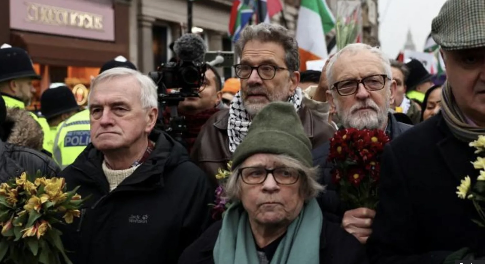
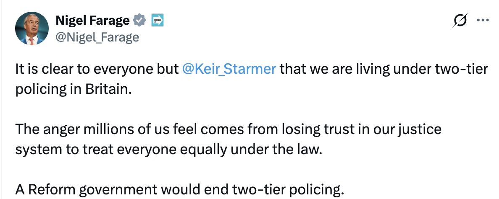

## Two-Tier Policing

::: {#fig-twotier layout-ncol=2} 

:::

'Two-tier' policing systems; i.e., where some groups are policed comparatively more than their counterparts. 

## Differential Policing 
\
These claims are not new, i.e., policing of Communists in post-war Italy, suppression of BLM in the United States, stop-and-search procedures in FL based on police partisanship. 

\

$\rightarrow$ All differential policing claims hinge on expectation of excess -- one side arrested, harassed, or faces worse sentencing than the other.  

## The Security Logic of Differential Policing 
\
Differential policing, broadly understood, is the securitisation of one group comparative
to another. The literature stresses that this is a routinised process where the behaviour
of securitising actors -- border control agents, police officers, traffic wardens, etc. --
creates a path dependency or an institutional posture (Bigo 2002). 

## The Disconnect in Democracy
\
Upending the rule of law so publicly is a risky strategy. The same asymmetry could be 
achieved with a sort of discriminatory leniency, which is considered a viable strategy 
in other political science research (Miller 2009; Holland 2016).

\

*Curiously,* there is no parallel in securitisation literature. There is the factual (the
positive case), its easement, but not the counterfactual (the negative case). Where absence is treated, it's assumed to be akin to a pre-treatment baseline. But, **there is a different between never treated and as of yet treated.**

## First Paper's Set-Up

**Research Question:** Does partisanship impact police response in Western liberal democracy? 

\

- Scope: DE, ES, FR, IT & UK (2020-2024)
- Data: ACLED protest data (NLP of text fields for actors and police response) 
      - IV: group partisanship (multi-stage classification w/ BART used for residuals)
      - DV: police response, disaggregated into deployment and coduct (more spec. arrest and brutality) (RoBERTa classification)
- Controls: weekend dummy, protestor violence, disruption (proximity to major street via OSM), visibility (proximity to gov't building via OSM), Country FE, Year FE 
- Methods: Heckman correction applied to separate deployment/attendance from conduct, logistic regression

::: {.small}
Nutley (2026), Who Is Spared? Selective Non-Securitisation and the Partisan Policing of
Protest in Western Europe, 2020–2024
:::

## First Paper's Findings
\
- Right-coded protests have about **20% lower odds** of police attending than left-coded protests
- Police conduct *once present* does not differ by partisanship
- So the asymmetry sits **upstream**, in where forces send officers

\

Runs counter to policing literature -- assumes excess that occurs at conduct-level. Strong suggestion that selective non-securitisation is occurring. 

## Gap and Theory 
\

Is that asymmetry fixed, or does it change as forces respond to repeated mobilisation?
:::{.small} Is this something we see with discrete events or is there a pattern?

\

Given Paper 1's finding, we assume that police response (deployment) is plausibly a punctuated process where threat assessments hold constant between encounters and are updated when police have contact with a mobilising group. 

## Expectations 
\

- **Under-policing:** offers fewer opportunities for threat revision, leaving low-threat risk assessments in place
- **Over-policing:** offers ample opportunity for threat revision, change over time

\ 

*Nota Bene:* Under-policing and non-securitisation are linked; as are over-policing and securitisation

## Matched Wake Analysis Explainer

Protests differ in many ways at once, so raw comparisons mislead.

\

- Pair each right-coded protest with a left-coded protest that looks the same on
  observed features (country, year, weekend, location, protest load)
- Compare what happens **in the wake** of each: police attendance at nearby
  protests over the following days and weeks
- Differences are not explained by those observed features

## {background-iframe="index.html" background-interactive="true"}

<!-- The interactive UK example fills this slide. Click into it to use the controls;
     press Esc or click outside to return to slide navigation. -->

## Matching

Coarsened exact matching of right- to left-coded protests on:

- country and year
- weekend
- distance to nearest government building (quartiles)
- same-day protest load (terciles)

Outcome: police-attended protests within **4 km**, at **7, 30 and 90 days**

## Main result

{fig-align="center" height="480"}

Gap of **−29.9%** (first week), **−17.6%** (30 days), **−14.5%** (90 days)

## Not a volume effect

- As many protests follow right- and left-coded protests (within 5%)
- Per follow-up protest, police attend less often after right-coded protests:

| Window | Rate ratio | 95% CI |
|---|---|---|
| 7 days | 0.71 | 0.63–0.79 |
| 30 days | 0.79 | 0.74–0.85 |
| 90 days | 0.83 | 0.79–0.88 |

## Halves, then holds

Differencing the cumulative windows:

- days 1–7: about **30%**
- days 8–30: about **13%**
- days 31–90: about **13%**

. . .

Does not widen (against strong H1), does not close (against H2)

## Which side moves?

{fig-align="center" height="440"}

Relative to typical protest: **right −21.4%**, **left +17.2%** in the first week

## Implications

- Partisan asymmetry is built into how attention is allocated **for months**
- It runs through **leniency** and **escalation** together
- Reforms aimed at officer conduct leave this upstream allocation untouched

## Next steps

- Heterogeneity: country, issue, violent protests
- Mechanisms: first vs repeated mobilisation; within- vs cross-force exposure
- Robustness: pre-trends, reporting bias, protest size
