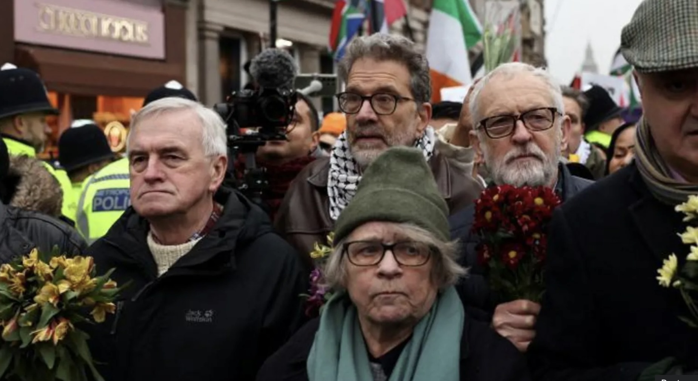
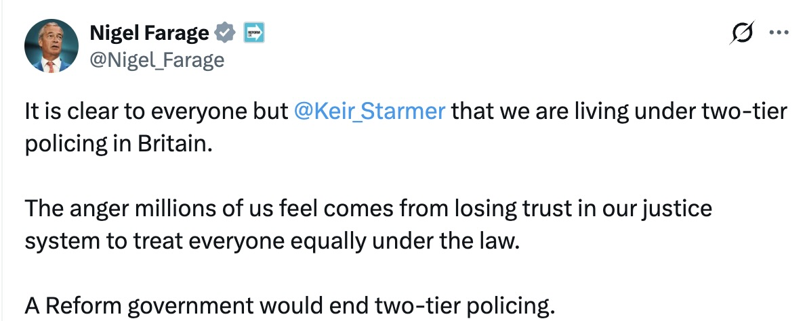

## Two-Tier Policing

::: {#fig-twotier layout-ncol=2}

:::

'Two-tier' policing: claims that some groups are policed more heavily than their counterparts.

## Differential Policing
\
These claims are not new: the policing of Communists in post-war Italy, the suppression of BLM in the United States, stop-and-search in Florida varying with police partisanship.

\

$\rightarrow$ All differential policing claims hinge on an expectation of excess: one side is arrested, harassed or sentenced more harshly than the other.

## The Security Logic of Differential Policing
\
Differential policing, broadly understood, is the securitisation of one group relative to another. The literature stresses that this is a routinised process: the behaviour of securitising actors (border agents, police officers, traffic wardens) creates a path dependency or an institutional posture (Bigo 2002).

## The Disconnect in Democracy
\
Upending the rule of law so publicly is a risky strategy. The same asymmetry could be achieved through discriminatory leniency, which other political science research treats as a viable strategy (Miller 2009; Holland 2016).

\

*Curiously,* there is no parallel in the securitisation literature. It covers the positive case and its easing, but not the negative case. Where absence is treated, it is assumed to be a pre-treatment baseline. But **there is a difference between never treated and not yet treated.**

## First Paper's Set-Up

**Research question:** Does partisanship shape police response in Western liberal democracies?

\

- Scope: DE, ES, FR, IT & UK (2020–2024)
- Data: ACLED protest data (NLP of text fields for actors and police response)
    - IV: group partisanship (multi-stage classification, BART for residual cases)
    - DV: police response, split into deployment and conduct (arrests, brutality) (RoBERTa classification)
- Controls: weekend, protester violence, disruption (distance to major road, OSM), visibility (distance to government building, OSM), country and year FE
- Methods: Heckman correction separating deployment from conduct; logistic regression

::: {.small}
Nutley (2026), Who Is Spared? Selective Non-Securitisation and the Partisan Policing of Protest in Western Europe, 2020–2024
:::

## First Paper's Findings
\
- Right-coded protests have about **20% lower odds** of police attending than left-coded protests
- Police conduct *once present* does not differ by partisanship
- So the asymmetry sits **upstream**, in where forces send officers

\

This runs counter to the policing literature, which looks for excess at the level of conduct. It strongly suggests selective non-securitisation.

## Gap and Question
\
Deployment is a repeated decision. Each protest can inform how a force approaches the next.

\

**Does the asymmetry persist beyond the protest itself, and if so, where does it sit?**

::: {.small}
In places? In accumulated experience? In the governing party? Or in the actors themselves?
:::

## Where Does the Classification Sit?

| Account | Police classify… | Prediction |
|---|---|---|
| Place-bound | areas | other protest nearby is policed differently afterwards |
| Cumulative | through experience | gap grows as a group keeps mobilising |
| Politically directed | by governing party | gap shifts with a change of government |
| **Actor-bound** | **groups** | **gap recurs whenever the group mobilises; nothing else changes** |

. . .

Two accounts need no classification at all: **spatial sorting** (right-coded protest happens where policing is lighter) and **protest composition** (who protests next changes).

## Matched Wake Analysis Explainer

Protests differ in many ways at once, so raw comparisons mislead.

\

- Pair each right-coded protest with a left-coded protest that looks the same on observed features
- Compare what happens **in the wake** of each: police-attended protests nearby over the following weeks
- Differences are not explained by those observed features

## {background-iframe="index.html" background-interactive="true"}

<!-- The interactive UK example fills this slide. Click into it to use the controls;
     press Esc or click outside to return to slide navigation.
     NOTE: check that its windows/radii match the final spec (1-4 weeks, 2-8 km). -->

## Matching

Coarsened exact matching of right- to left-coded protests, **within the same police jurisdiction**:

- police jurisdiction × urban–rural type
    - FR/IT/ES: département / province · DE: Land · UK: 44 police forces
- year, weekend
- distance to nearest government building (quartiles)
- same-day protest load in the jurisdiction (none / below / above median)
- prior protest history and pre-trend in police attention

\

Outcome: police-attended protests within **2–8 km**, over **1–4 weeks** (whole weeks, to balance weekdays)

Poisson, CEM-weighted, errors clustered by NUTS 2 region

## Step 1: Much of the Gap Is Geography

- Matched only within country: a large gap in police attention after right-coded protests
- Matched within police jurisdiction: much of it disappears

\

$\rightarrow$ Right-coded protest happens disproportionately where policing is lighter overall. Cross-national comparisons overstate persistence.

## Step 2: A Consistent but Imprecise Gap

Police-attended protests after right- vs matched left-coded protests (% change, Poisson)

| | 2 km | 4 km | 6 km | 8 km |
|---|---|---|---|---|
| 1 week | −11.6 | **−13.3** | −17.0 | −13.0 |
| 1–2 weeks | −5.9 | −8.3 | −9.7 | −4.6 |
| 1–3 weeks | −1.3 | −6.2 | −8.4 | −1.3 |
| 1–4 weeks | −12.7\* | −18.0\* | −2.7 | −1.2 |

::: {.small}
\* p < 0.1, clustered. Headline (pre-specified): 1 week, 4 km, 95% CI −30.7 to +8.4. all 16 cells negative; 105 of 112 leave-one-out estimates negative.
:::

## Step 3: Who Protests Next

Follow-up protests within 4 km after right- vs matched left-coded protests

| | 1 week | 2 weeks | 3 weeks | 4 weeks |
|---|---|---|---|---|
| Right-coded | **+54%\*\*\*** | **+56%\*\*\*** | **+46%\*\*\*** | +33%\*\* |
| Left-coded | **−21%\*\*\*** | **−14%\*\*\*** | −8%\*\* | −2% |
| Unclassified | +1% | +2% | +10%\* | +7% |

::: {.small}
Near-identical at every radius from 2 to 8 km. \*\*\* p < 0.01, \*\* p < 0.05, \* p < 0.1.
:::

## How Follow-Ups Are Policed

Share of follow-up protests with police present, after right / after left (4 km)

| | 1 week | 2 weeks | 3 weeks | 4 weeks |
|---|---|---|---|---|
| Right-coded | 3.2 / 6.0 | 3.2 / 3.2 | 2.5 / 2.2 | 2.9 / 3.2 |
| Left-coded | 4.0 / 4.0 | 3.7 / 4.4 | 3.6 / 3.3 | 3.4 / 3.6 |

\

- Left-coded protest is policed the same whatever came before
- Right-coded protest is policed less than left-coded protest **wherever it occurs**
- The mix shifts towards the protest police attend less, so attention dips, then recovers

## Over Time and Across Governments

**Self-exciting models** (jurisdiction-day panel, no matching)

- Right-coded protest is self-exciting at 4–7 days; it suppresses left-coded protest at 1–3 days
- No decline in police attention as a right-wing group keeps mobilising $\rightarrow$ no habituation

\

**Changes of government** (DE 2021, IT 2022, UK 2024)

- Protests aligned with the government are, if anything, policed slightly *more*
- No consistent shift $\rightarrow$ not politically directed

## What the Evidence Rules Out

| Account | Verdict |
|---|---|
| Spatial sorting | **Partly**: explains much of the cross-national gap |
| Place-bound | **No**: other protest nearby is policed much the same |
| Cumulative | **No**: no habituation |
| Politically directed | **No**: no shift with government change |
| Composition + actor-bound | **Consistent**: the gap follows where right-coded protest occurs |

::: {.small}
One caveat: unclassified follow-ups are policed somewhat less at 3–4 weeks.
:::

## Robustness

- **Cross-jurisdiction matching** (similar forces, same country): gap ≈ 0
- **Border design**: not feasible (only 40–140 matched protests near borders)
- **Excluding government-only labels** (1,393 protests): unchanged; 4 weeks, 4 km = −19.8% (p = 0.03)
- **Placebo**: no pre-period difference (1 of 20 cells, as expected by chance)
- **Disruption**: matching on distance to a major road leaves estimates unchanged

## Implications

- Partisan asymmetry in policing **travels with the actors**, not the places
- Right-wing mobilisation reshapes local protest, and the policing gap **compounds through protest dynamics**
- Reforms aimed at officer conduct, or at area-based deployment, miss where the classification sits

## Next Steps

- **Decisive test:** is the *same named organisation* policed less across jurisdictions and over time?
- Pre-register it and confirm on 2025 data
- Heterogeneity: Italy strongest; Spain reversed; country rerun on final spec
- Riots as follow-up events; balance table; Spanish autonomous police forces